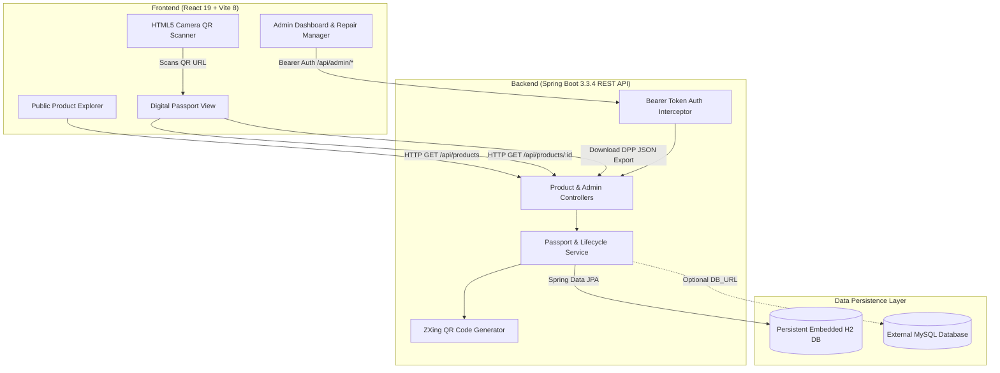

# 🌿 ProductLife — Digital Product Passport (DPP) Platform

[](https://openjdk.org/)
[](https://spring.io/projects/spring-boot)
[](https://react.dev/)
[](https://vitejs.dev/)
[](https://www.h2database.com/)
[](https://www.mysql.com/)
[](https://commission.europa.eu/energy-climate-change-environment/standards-tools-and-labels/products-labelling-rules-and-requirements/sustainable-products/ecodesign-sustainable-products-regulation_en)
[](LICENSE)

> **ProductLife** is a full-stack, enterprise-grade **Digital Product Passport (DPP)** platform. Designed in alignment with the **European Union Ecodesign for Sustainable Products Regulation (ESPR)**, ProductLife establishes verifiable product transparency across manufacturing, consumer ownership, repair maintenance, and circular recycling recovery.

---

## 📖 Table of Contents
- [Executive Overview](#-executive-overview)
- [Core Architecture & Workflow](#-core-architecture--workflow)
- [Key Features](#-key-features)
- [Technology Stack](#-technology-stack)
- [Live Services & Endpoints](#-live-services--endpoints)
- [Quick Start Guide](#-quick-start-guide)
- [Default Demonstration Data & Credentials](#-default-demonstration-data--credentials)
- [REST API Reference](#-rest-api-reference)
- [Database Configuration (H2 & MySQL)](#-database-configuration-h2--mysql)
- [Testing & Quality Assurance](#-testing--quality-assurance)
- [Project Directory Structure](#-project-directory-structure)
- [Contributing & License](#-contributing--license)

---

## 🌍 Executive Overview

The circular economy requires knowing **what** a product is made of, **who** made it, **how** to care for and repair it, and **where** to recycle it. 

Traditional products lose this information the moment the paper tag or packaging is thrown away. **ProductLife** solves this by generating an unforgeable, permanently accessible digital passport tied directly to a 2D QR code engraved or printed onto each item.

```
🏭 Manufacturer        📦 Product Tag        📱 Consumer / Recycler        ♻️ Circular Recovery
Registers specs,    ──> Prints unique   ──> Instant mobile scan       ──> Accesses bill of
materials & care        QR code             (Zero app installation)       materials & disassembly
```

### Why Digital Product Passports?
1. **Right to Repair:** Certified service centers record repair logs and maintenance actions, prolonging product lifespan.
2. **Anti-Greenwashing:** Granular bill of materials (e.g., *92% Recycled 304 Stainless Steel*) provides verifiable circular claims.
3. **Automated Recycling Sorting:** Recyclers immediately know safe disassembly procedures and hazardous components.
4. **EU Compliance:** Aligns with European digital compliance mandates via standardized JSON exports (`EU-DPP-1.0-ALIGNED`).

---

## 🏛️ Core Architecture & Workflow

ProductLife adopts a modern, decoupled client-server architecture:



### End-to-End Lifecycle Workflow:
1. **Product Registration:** Administrators register durable goods with detailed provenance, materials breakdown, and care guides.
2. **Passport Generation:** An immutable passport code (e.g., `PL-ECO-001`) is issued with database persistence.
3. **QR Generation:** Google ZXing produces high-resolution, print-ready vector/PNG QR codes encoding the canonical passport URL.
4. **Mobile & Scanner Access:** Consumers scan via smartphone camera or using the built-in webcam scanner (`html5-qrcode`).
5. **Lifecycle Logging:** Authorized service hubs log battery replacements, gasket changes, and acoustic calibrations with timestamped technician notes.
6. **Compliance Export:** Regulators and circularity auditors download machine-readable JSON disclosures with one click.

---

## ✨ Key Features

| Feature | Description |
|---|---|
| 🛡️ **Digital Product Passports** | Complete provenance, manufacturing dates, model identifiers, origin country, and care instructions. |
| 🧪 **Circularity Disclosures** | Granular materials breakdown, recycling guidelines, and disassembly safety warnings. |
| 📷 **Dual QR Integration** | Server-side high-resolution PNG generation via ZXing + client-side live webcam scanner powered by `html5-qrcode`. |
| 🔧 **Lifecycle Repair History** | Timestamped maintenance records tracking service centers, replaced components, and technician inspection notes. |
| 🇪🇺 **EU DPP Compliance Export** | Generates schema-compliant `EU-DPP-1.0-ALIGNED` JSON payloads for regulatory reporting. |
| 🔐 **Secure Administration Portal** | Protected administration suite with Bearer token authentication, product creation forms, and repair CRUD controls. |
| 💾 **Zero-Setup Dual Persistence** | Runs instantly out-of-the-box using embedded persistent H2 (MySQL mode) with seamless support for production MySQL. |

---

## 💻 Technology Stack

### Backend
- **Language & Runtime:** Java 17 LTS (Amazon Corretto / Oracle OpenJDK)
- **Framework:** Spring Boot 3.3.4
- **Persistence:** Spring Data JPA, Hibernate 6.5
- **Databases:** 
  - Embedded H2 2.2 (`MODE=MySQL`, file persistence at `./data/productlife`)
  - MySQL 8.x Connector (`mysql-connector-j`)
- **QR Generation:** Google ZXing (Zebra Crossing) 3.5.3 (`core`, `javase`)
- **Validation:** Jakarta Bean Validation (Hibernate Validator)
- **Build Tool:** Apache Maven 3.10 Wrapper (`mvnw`)

### Frontend
- **Runtime:** Node.js 18+ (tested on Node v24)
- **Framework:** React 19
- **Build Tool & Bundler:** Vite 8
- **Routing:** React Router DOM v7
- **Icons:** Lucide React
- **Camera Scanning:** `html5-qrcode` 2.3.8
- **Styling:** Custom responsive CSS design system (eco-emerald palette, responsive grids, glassmorphism modal dialogs)

---

## 🚦 Live Services & Endpoints

When running locally, ProductLife exposes the following services:

| Service | Local Address | Description |
|---|---|---|
| **Frontend Web App** | [http://localhost:5174](http://localhost:5174) | Public Explorer, Scanner & Admin Portal |
| **Backend REST API** | [http://localhost:8081](http://localhost:8081) | Core RESTful API root |
| **API Health Check** | [http://localhost:8081/api/health](http://localhost:8081/api/health) | System health & live DB connectivity monitor |
| **H2 Web Console** | [http://localhost:8081/h2-console](http://localhost:8081/h2-console) | Database browser (JDBC URL: `jdbc:h2:file:./data/productlife`) |

---

## 🚀 Quick Start Guide

### Prerequisites
Make sure your workstation has:
1. **Java JDK 17+** (`java -version`)
2. **Node.js 18+ & npm** (`node -v`, `npm -v`)

---

### Option A: One-Click Startup (Windows)
Double-click the included batch launcher in the root directory:
```powershell
.\start_project.bat
```
This automatically launches the Spring Boot backend on port `8081` and the Vite frontend on port `5174` in separate dedicated terminals.

---

### Option B: Manual Startup

#### 1. Start the Backend:
```powershell
# Navigate to backend directory
cd backend

# Launch backend via PowerShell launcher (auto-sets JAVA_HOME and loads .env)
.\run_backend.ps1

# Or run directly via Maven wrapper:
.\mvnw.cmd spring-boot:run
```
*The Spring Boot server will initialize, create tables, seed 4 demonstration products, and start listening on port `8081`.*

#### 2. Start the Frontend:
```powershell
# In a new terminal, navigate to frontend directory
cd frontend

# Install dependencies (first time only)
npm install

# Start Vite dev server
npm run dev
```
*Open [http://localhost:5174](http://localhost:5174) in your web browser.*

---

## 🔑 Default Demonstration Data & Credentials

Upon initial launch, the system automatically seeds **4 baseline products** and **3 verified repair records**:

| ID | Passport Code | Product Name | Category | Origin | Seeded Repairs |
|---|---|---|---|---|---|
| `1` | `PL-ECO-001` | **HydroPure Thermal Flask 750ml** | Drinkware | Sweden | 1 (Stockholm Hub) |
| `2` | `PL-TEX-002` | **PureStride Circular Running Sneaker** | Footwear | Portugal | 0 (Pristine) |
| `3` | `PL-ELE-003` | **Modular Sound Wireless Headphones** | Electronics | Germany | 2 (Berlin & Munich) |
| `4` | `PL-OUT-004` | **TerraShield Solar Exploration Backpack** | Gear | Vietnam | 0 (Pristine) |

### 🛡️ Administrator Credentials
To access the protected management portal at [http://localhost:5174/admin/login](http://localhost:5174/admin/login):
- **Username:** `admin`
- **Password:** `admin123`

---

## 📡 REST API Reference

### Public Passport Endpoints
| Method | Endpoint | Query Params | Description |
|---|---|---|---|
| `GET` | `/api/health` | — | Returns server status, uptime, and database connectivity. |
| `GET` | `/api/products` | `keyword`, `category` | Retrieves product catalog with optional search and filters. |
| `GET` | `/api/products/categories` | — | Retrieves all distinct product categories. |
| `GET` | `/api/products/{id}` | — | Retrieves complete digital passport by numeric database ID. |
| `GET` | `/api/products/code/{code}` | — | Retrieves complete digital passport by passport code (e.g. `PL-ECO-001`). |
| `GET` | `/api/products/{id}/qrcode` | `size`, `baseUrl` | Generates a dynamic scannable PNG QR code graphic. |
| `GET` | `/api/products/{id}/qrcode/data-url`| `size` | Returns Base64 Data URL string for inline web embedding. |
| `GET` | `/api/products/{id}/export/json` | — | Exports EU-compliant DPP JSON payload (`EU-DPP-1.0-ALIGNED`). |

### Protected Administrator Endpoints
*(Requires `Authorization: Bearer <token>` header)*

| Method | Endpoint | Description |
|---|---|---|
| `POST` | `/api/admin/auth/login` | Authenticates administrator and returns a Bearer session token. |
| `POST` | `/api/admin/auth/logout` | Terminates active administrator session and invalidates token. |
| `GET` | `/api/admin/products` | Retrieves all products for management view. |
| `POST` | `/api/admin/products` | Registers a new product into the catalog. |
| `PUT` | `/api/admin/products/{id}` | Updates existing product details and materials disclosures. |
| `DELETE`| `/api/admin/products/{id}` | Deletes a product from the database. |
| `GET` | `/api/admin/products/{id}/repairs` | Retrieves repair history records for a product. |
| `POST` | `/api/admin/products/{id}/repairs` | Adds a new repair/maintenance log to a product. |
| `PUT` | `/api/admin/products/{id}/repairs/{repairId}` | Updates an existing repair record. |
| `DELETE`| `/api/admin/products/{id}/repairs/{repairId}` | Removes a repair record. |

---

## 🗄️ Database Configuration (H2 & MySQL)

ProductLife features a **zero-configuration dual database architecture**.

### 1. Embedded H2 Database (Default)
By default, the application runs on **embedded H2** in MySQL compatibility mode.
- **Zero Installation:** Requires no background services or database configuration.
- **Persistent:** Stored in file format under `backend/data/productlife.mv.db`, preserving all changes between restarts.
- **Web Inspection:** Inspect data anytime at [http://localhost:8081/h2-console](http://localhost:8081/h2-console):
  - JDBC URL: `jdbc:h2:file:./data/productlife`
  - User Name: `sa`
  - Password: *(blank)*

### 2. External MySQL Database (Production / Team)
To switch to an external MySQL server, set the following environment variables or create `backend/.env`:

```env
# backend/.env
DB_URL=jdbc:mysql://127.0.0.1:3306/productlife?createDatabaseIfNotExist=true&useSSL=false&allowPublicKeyRetrieval=true&serverTimezone=UTC
DB_USERNAME=productlife_app
DB_PASSWORD=your_secure_password

ADMIN_USERNAME=admin
ADMIN_PASSWORD=admin123
```
*Spring Boot will automatically detect the MySQL driver, configure the MySQL Hibernate dialect, and connect seamlessly.*

---

## 🧪 Testing & Quality Assurance

ProductLife includes an end-to-end integration test suite verifying backend health, database consistency, QR generation, role authentication, and repair CRUD operations.

To execute the test suite:
```powershell
node scripts/live_phase8_verification.js
```

### Verification Checklist (52 Passing Checks):
- [x] Step 1: Backend Health & Database Connectivity (`/api/health`)
- [x] Step 2: Verification of all 4 baseline products
- [x] Step 3: Verification of 3 baseline repair records across service hubs
- [x] Step 4: Public QR Code PNG generation for all products
- [x] Step 5: Admin authentication rejection on invalid password & unauthenticated endpoints
- [x] Step 6: Full Repair Lifecycle CRUD (Create repair, Update repair, Delete repair, restore baseline)
- [x] Step 7: EU DPP Standard Compliance JSON Schema export verification
- [x] Step 8: Administrator token invalidation and logout
- [x] Step 9: Database consistency & record preservation confirmation

---

## 📁 Project Directory Structure

```
ProductLife/
├── .gitignore                          # Workspace gitignore (excludes builds & secrets)
├── README.md                           # Project documentation
├── start_project.bat                   # One-click Windows startup script
│
├── backend/                            # Spring Boot 3.3.4 Java Backend
│   ├── .env.example                    # Environment variable template
│   ├── mvnw / mvnw.cmd                 # Maven 3.10 wrapper scripts
│   ├── pom.xml                         # Maven dependencies (Spring Boot, H2, MySQL, ZXing)
│   ├── run_backend.ps1                 # Automated launcher with JDK 17 detection
│   └── src/
│       ├── main/java/com/productlife/
│       │   ├── config/                 # Security interceptors, CORS, DataInitializer
│       │   ├── controller/             # Public & Admin REST Controllers
│       │   ├── dto/                    # Data transfer objects & EU DPP Export schema
│       │   ├── entity/                 # Product & RepairHistory JPA entities
│       │   ├── exception/              # Global REST exception handlers
│       │   ├── repository/             # Spring Data JPA repositories
│       │   └── service/                # Business logic & ZXing QR generator
│       └── main/resources/
│           └── application.properties  # Datasource, port 8081, and admin configuration
│
├── frontend/                           # React 19 + Vite 8 Single Page App
│   ├── package.json                    # Dependencies (React 19, Lucide, html5-qrcode)
│   ├── vite.config.js                  # Vite dev server configuration (port 5174)
│   ├── public/                         # Favicon and SVG vector assets
│   └── src/
│       ├── components/                 # Navbar, Footer, QrModal, ProductCard
│       ├── context/                    # AdminAuthContext session provider
│       ├── pages/                      # Home, Explorer, PassportDetail, Scanner, About
│       │   └── admin/                  # AdminDashboard, AdminProductForm, AdminLogin
│       └── services/                   # Frontend REST API & Admin API clients
│
└── scripts/
    └── live_phase8_verification.js     # 52-step end-to-end integration test runner
```

---

## 🤝 Contributing & License

Contributions, feature proposals, and bug fixes are welcome! Feel free to open an issue or submit a pull request.

This project is licensed under the **MIT License**.
